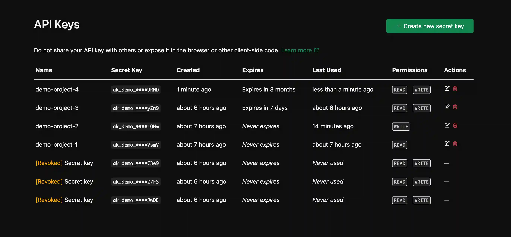
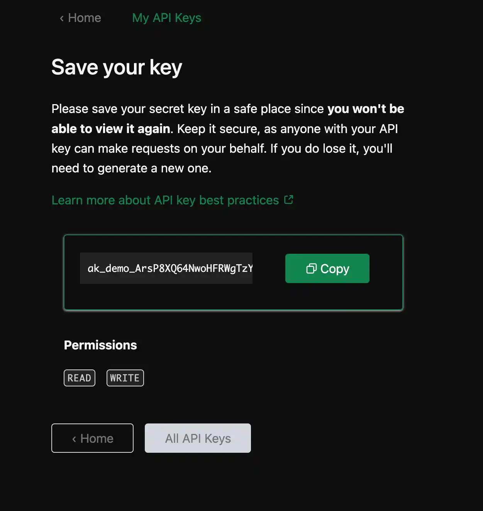
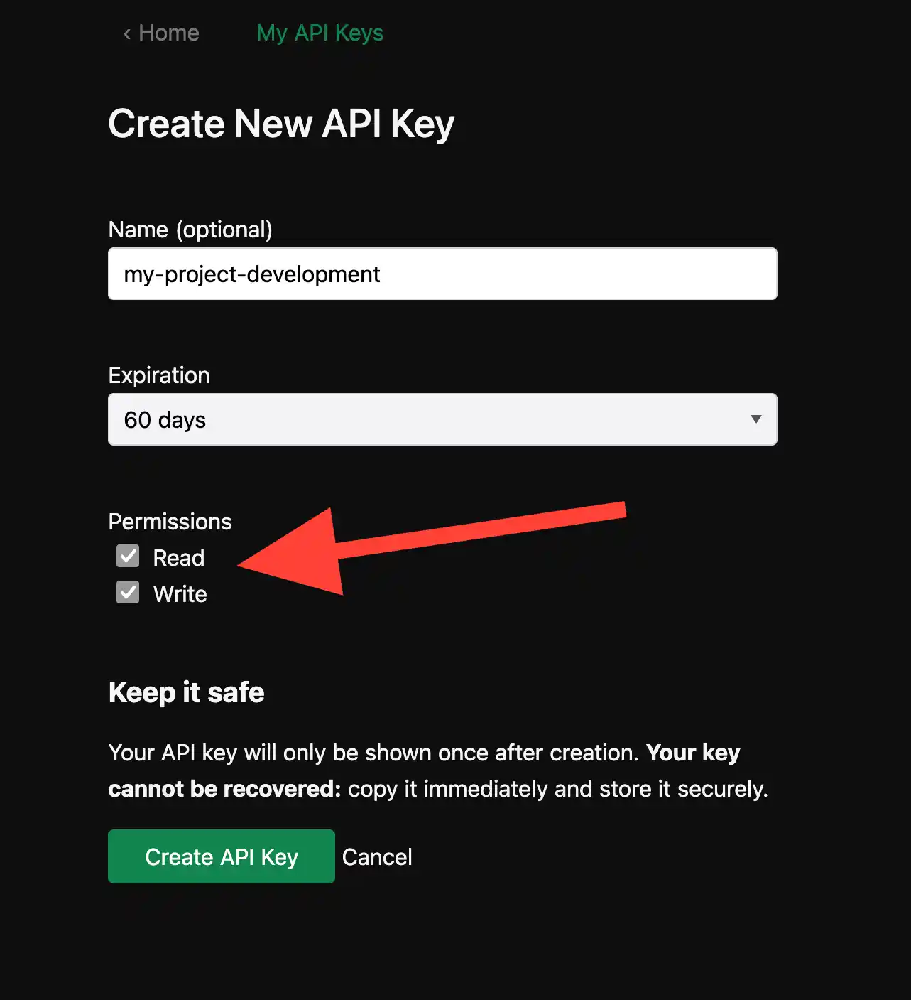

# 🔑 `api_keys` – Secure API keys for your Rails app

[](https://badge.fury.io/rb/api_keys) [](https://github.com/rameerez/api_keys/actions)

> [!TIP]
> **🚀 Ship your next Rails app 10x faster!** I've built **[RailsFast](https://railsfast.com/?ref=api_keys)**, a production-ready Rails boilerplate template that comes with everything you need to launch a software business in days, not weeks. Go [check it out](https://railsfast.com/?ref=api_keys)!

`api_keys` makes it simple to add secure, production-ready API key authentication to any Rails app. Generate keys, restrict scopes, auto-expire tokens, revoke tokens, and gate endpoints. It also provides a self-serve dashboard for users to issue and manage their own API keys. Secret tokens are hashed and shown only once. Plaintext is stored only for a key type that you explicitly mark as public and limit to a finite permission set.

[ 🟢 [Live interactive demo website](https://apikeys.rameerez.com) ]



Check out my other 💎 Ruby gems: [`allgood`](https://github.com/rameerez/allgood) · [`usage_credits`](https://github.com/rameerez/usage_credits) · [`profitable`](https://github.com/rameerez/profitable) · [`nondisposable`](https://github.com/rameerez/nondisposable)

## Installation

Add this line to your application's Gemfile:

```ruby
gem "api_keys"
```

And then `bundle install`. After the gem is installed, run the generator and migration:

```bash
rails g api_keys:install
rails db:migrate
```

And you're done!

### Upgrading an existing installation

Install the bounded bcrypt authentication lookup index before deploying the current hardening changes:

```bash
rails generate api_keys:add_authentication_index
rails db:migrate
```

The generated migration is idempotent and uses a concurrent PostgreSQL index where supported.

To lock keys to specific web origins or IP addresses (see [Restrict where a key can be used](#restrict-where-a-key-can-be-used-origins-and-ips)), add the restrictions column:

```bash
rails generate api_keys:add_restrictions
rails db:migrate
```

New installations get this column from the start, so this is only for upgrades.

To record refused requests on each key (see [Refused requests](#refused-requests-why-a-key-is-not-working)) and make the one-time token page durable (see [What "one-time" guarantees](#what-one-time-guarantees)), add the 0.6.0 columns in one migration:

```bash
rails generate api_keys:add_key_activity
rails db:migrate
```

New installations get these columns from the start too. Until an existing app runs the migration, authentication keeps working exactly as before, refusals are simply not recorded, and the one-time token page relies on the cache marker alone, as in 0.5.1.

## Quick Start

Just add `has_api_keys` to your desired model. For example, if you want your `User` records to have API keys, you'd have:

```ruby
class User < ApplicationRecord
  has_api_keys
end
```

You can also customize how many maximum keys your users can have by passing a block to `has_api_keys`, like this:

```ruby
class User < ApplicationRecord
  has_api_keys do
    max_keys 10 # only 10 active API keys per user allowed
    require_name true # always require users to set a name for each API key
  end
end
```

It'd work the same if you want your `Organization` or your `Project` records to have API keys.

### Mount the dashboard engine so your users can self-serve API keys

The goal of `api_keys` is to allow you to turn your Rails app into an API platform with secure key authentication in minutes, as in: drop in this gem and you're pretty much done with API key management.

To achieve that, the gem provides a ready-to-go dashboard you can just mount in your `routes.rb` like this:

```ruby
mount ApiKeys::Engine => '/settings/api-keys'
```

#### Default behavior (User-owned keys)

By default, the dashboard expects:
- A `current_user` method that returns the currently logged-in user
- An `authenticate_user!` method that ensures a user is logged in

This works out-of-the-box with Devise and most authentication solutions where `User` owns the API keys.

#### Custom owner models (Organization, Team, etc.)

If your API keys belong to a different model (e.g., `Organization`), you **must** configure the dashboard in your initializer:

```ruby
# config/initializers/api_keys.rb
ApiKeys.configure do |config|
  # Tell the dashboard how to find the current API key owner
  config.current_owner_method = :current_organization
  
  # Tell the dashboard how to ensure the owner is authenticated
  config.authenticate_owner_method = :authenticate_organization!
end
```

These methods must exist in your `ApplicationController` (or wherever the engine is mounted). For example:

```ruby
class ApplicationController < ActionController::Base
  def current_organization
    # Your logic to return the current organization
    @current_organization ||= Organization.find(session[:organization_id])
  end
  
  def authenticate_organization!
    redirect_to login_path unless current_organization
  end
end
```

If the mounted dashboard should inherit from a different controller, configure it in the same initializer before the engine controllers load:

```ruby
ApiKeys.configure do |config|
  config.parent_controller = "Admin::ApplicationController"
end
```

The setting accepts a controller class or a valid constant-name string and defaults to `::ApplicationController`.

#### Common scenarios

**Organization with user membership:**
```ruby
# When organizations own keys but users manage them
config.current_owner_method = :current_organization
config.authenticate_owner_method = :require_organization_member!
```

**Multi-tenant applications:**
```ruby
# When each tenant/account owns keys
config.current_owner_method = :current_account
config.authenticate_owner_method = :authenticate_account!
```

**Team-based ownership:**
```ruby
# When teams own keys
config.current_owner_method = :current_team  
config.authenticate_owner_method = :ensure_team_access!
```

#### What the dashboard provides

Once configured, your users can:
- self-issue new API keys
- set expiration dates
- attach scopes / permissions to individual keys (the edit form changes only the scopes it shows, the owner's default scopes, keeps any other scope a key holds, and drops a held scope its type no longer allows; keys of a `scopes: :ceiling` type show their live permissions instead, on the creation form as soon as such a type is selected, and the dashboard never takes scopes for them)
- add and edit the key names
- lock a key to specific web origins or IP addresses
- revoke instantly
- see the status of all their keys
- see when a key's requests are arriving but being refused, and why

It provides an UI with everything you'd expect from an API keys dashboard, working right out of the box:



To make the experience between your app and the `api_keys` dashboard more seamless, you can configure a `return_url` and `return_text` so your users can quickly go back to your app or settings page (in the screenshot above, that's the "Home" links, text customizable)

You can check out the dashboard on the [live demo website](https://apikeys.rameerez.com).

### Customizing the Dashboard

The gem provides two levels of customization for the mounted dashboard:

#### Level 1: Use the stock dashboard (default)
Works out of the box with good defaults. No configuration needed.

#### Level 2: Override CSS variables
Tweak colors and spacing by overriding CSS variables in your application's stylesheet:

```css
:root {
  --api-keys-primary-color: #your-brand-color;
  --api-keys-danger-color: #dc3545;
  --api-keys-success-color: #28a745;
  --api-keys-badge-secret-bg: #e7f1ff;
  --api-keys-badge-publishable-bg: #fef3cd;
  /* See layout file for all available variables */
}
```

Engine pages ship an enforcing Content Security Policy. The default allows same-origin scripts, styles, and fonts, so your own stylesheet loads normally — see [Dashboard Content Security Policy](#dashboard-content-security-policy) to tighten or disable it.

#### Building Custom Integrations

If you need complete control over the UI (e.g., to match your design system with Tailwind, Bootstrap, etc.), you can build your own views and controllers while using the gem's model layer and helpers.

The gem provides a comprehensive set of helpers specifically designed for custom integrations. These patterns are battle-tested from real production integrations.

##### What You'll Need

A complete custom integration typically requires:

| Component | Purpose |
|-----------|---------|
| Initializer | Configure the gem + opt into form helpers |
| Routes | RESTful resources (~6 lines) |
| Controller | Handle CRUD operations (~90 lines) |
| Views | index, new, edit, success pages |
| Helper include | One line in ApplicationHelper |

##### Quick Setup

**1. Initializer** (`config/initializers/api_keys.rb`):

```ruby
# Include form builder extensions for cleaner forms
Rails.application.config.to_prepare do
  ActionView::Helpers::FormBuilder.include(ApiKeys::FormBuilderExtensions)
end

ApiKeys.configure do |config|
  config.current_owner_method = :current_organization
  config.authenticate_owner_method = :authenticate_organization!
  # ... other config
end
```

**2. Routes** (`config/routes.rb`):

```ruby
namespace :settings do
  resources :api_keys, only: [:index, :new, :create, :edit, :update] do
    post :revoke, on: :member
    get :success, on: :collection
    post :create_publishable, on: :collection  # If using key types
  end
end
```

**3. Helper** (`app/helpers/application_helper.rb`):

```ruby
module ApplicationHelper
  include ApiKeys::ViewHelpers
end
```

**4. Controller** - See the complete example below.

---

### Complete Controller Example

Here's a production-ready controller (~90 lines) that handles all API key operations:

```ruby
# app/controllers/settings/api_keys_controller.rb
module Settings
  class ApiKeysController < ApplicationController
    before_action :set_api_key, only: [:edit, :update, :revoke]
    before_action :set_available_scopes, only: [:new, :create, :edit, :update]

    def index
      @publishable_key = current_organization.api_keys.publishable.active.first
      @secret_keys = current_organization.api_keys.secret.active.order(created_at: :desc)
      @inactive_keys = current_organization.api_keys.secret.inactive.order(created_at: :desc)
    end

    def new
      @api_key = current_organization.api_keys.build(key_type: :secret)
    end

    def create
      @api_key = current_organization.create_api_key!(
        name: api_key_params[:name],
        key_type: :secret,
        scopes: api_key_params[:scopes],
        expires_at_preset: params.dig(:api_key, :expires_at_preset)
      )

      ApiKeys::TokenSession.store(session, @api_key)
      redirect_to success_settings_api_keys_path
    rescue ActiveRecord::RecordInvalid => e
      @api_key = e.record
      flash.now[:alert] = "Failed to create API key."
      render :new, status: :unprocessable_entity
    end

    def success
      @token = ApiKeys::TokenSession.retrieve_once(session, api_key: @api_key)
      redirect_to settings_api_keys_path, alert: "Token can only be shown once." and return if @token.blank?
    end

    def edit
    end

    def update
      if @api_key.update(api_key_params)
        redirect_to settings_api_keys_path, notice: "API key updated."
      else
        flash.now[:alert] = "Failed to update API key."
        render :edit, status: :unprocessable_entity
      end
    end

    def create_publishable
      unless current_organization.can_create_api_key?(key_type: :publishable)
        redirect_to settings_api_keys_path, alert: "You already have a publishable key."
        return
      end

      current_organization.create_api_key!(name: "SDK Key", key_type: :publishable)
      redirect_to settings_api_keys_path, notice: "Publishable key created!"
    rescue ActiveRecord::RecordInvalid => e
      redirect_to settings_api_keys_path, alert: "Failed to create key."
    end

    def revoke
      if @api_key.revocable?
        @api_key.revoke!
        redirect_to settings_api_keys_path, notice: "API key revoked."
      else
        redirect_to settings_api_keys_path, alert: "This key cannot be revoked."
      end
    end

    private

    def set_api_key
      @api_key = current_organization.api_keys.find(params[:id])
    end

    def set_available_scopes
      @available_scopes = current_organization.available_api_key_scopes
    end

    def api_key_params
      params.require(:api_key).permit(:name, scopes: [])
    end
  end
end
```

---

### Model Scopes

Filter keys by type and status:

```ruby
# By key type (when using key_types feature)
@org.api_keys.publishable          # Only publishable keys
@org.api_keys.secret               # Secret keys (and legacy keys without type)

# By status
@org.api_keys.active               # Not revoked and not expired
@org.api_keys.inactive             # Revoked or expired
@org.api_keys.expired              # Past expiration date
@org.api_keys.revoked              # Manually revoked

# By request restrictions
@org.api_keys.restricted           # Locked to specific origins and/or IPs
@org.api_keys.unrestricted         # Usable from anywhere

# Chain them
@org.api_keys.publishable.active
@org.api_keys.secret.inactive.order(created_at: :desc)
```

---

### Owner Instance Methods

Methods available on any model with `has_api_keys`:

```ruby
# Get available scopes for forms
@available_scopes = current_org.available_api_key_scopes
# Returns owner-specific scopes, or falls back to global config

# Check if owner can create a key (respects limits)
current_org.can_create_api_key?(key_type: :publishable)
# => false if limit reached

# Create a key with all options
@api_key = current_org.create_api_key!(
  name: "My Key",
  key_type: :secret,                    # or :publishable
  scopes: ["read", "write"],            # Blank values auto-removed; [] means none, omit for defaults
  expires_at: 30.days.from_now,         # Explicit date
  expires_at_preset: "30_days",         # OR use preset (takes precedence)
  environment: :live,                   # Defaults to current_environment
  metadata: { team: "backend" },        # Optional JSON metadata
  allowed_origins: "example.com",       # Optional: lock to web origins
  allowed_ips: "10.0.0.0/8"             # Optional: lock to IP addresses
)
```

---

### API Key Instance Methods

Methods available on `ApiKeys::ApiKey` instances:

```ruby
# Token (only available immediately after creation)
@api_key.token                    # => "sk_live_abc123..." (plaintext, once only)

# Display
@api_key.masked_token             # => "sk_live_••••abc1" (safe for UI)
@api_key.viewable_token           # => full token if public key type, nil otherwise

# Status checks
@api_key.active?                  # => true if not revoked and not expired
@api_key.expired?                 # => true if past expires_at
@api_key.revoked?                 # => true if manually revoked
@api_key.revocable?               # => false for non-revocable key types

# Type checks (when using key_types)
@api_key.public_key_type?         # => true if token can be viewed again
@api_key.key_type                 # => "publishable", "secret", or nil
@api_key.environment              # => "test", "live", or nil

# Actions
@api_key.revoke!                  # Revoke the key (raises if not revocable)

# Scopes
@api_key.scopes                   # => ["read", "write"]
@api_key.allows_scope?("read")    # => true
@api_key.scopes_follow_ceiling?   # => true for `scopes: :ceiling` key types

# Request restrictions (where the key may be used from)
@api_key.allowed_origins          # => ["example.com", "*.example.com"]
@api_key.allowed_ips              # => ["203.0.113.7", "10.0.0.0/8"]
@api_key.restricted?              # => true if either list has entries
@api_key.restrictions             # => ApiKeys::Restrictions value object

# Metadata
@api_key.name                     # => "Production Server"
@api_key.created_at
@api_key.expires_at
@api_key.last_used_at
@api_key.requests_count           # If tracking enabled

# Refused requests (the key's real token, refused by a policy)
@api_key.last_refused_at          # => 2026-10-18 12:00:00 UTC, or nil
@api_key.last_refusal_code        # => "origin_not_allowed", or nil
@api_key.refusals_count           # If tracking enabled
```

---

### Token Session Helper

Manages the "show token once" pattern for secret keys. The helper encrypts each handoff with an application-derived AES-256-GCM key, binds it to the created key, expires it after ten minutes, and deletes it on first retrieval. The session contains only ciphertext and the non-secret key ID—not the plaintext token—even when the host uses Rails' encrypted cookie session store.

```ruby
# Store token after creation
ApiKeys::TokenSession.store(session, @api_key)

# Retrieve and clear, bound to the expected key (nil on mismatch or reuse)
@token = ApiKeys::TokenSession.retrieve_once(session, api_key: @api_key)

# With custom session key (if managing multiple token types)
ApiKeys::TokenSession.store(session, @api_key, key: :my_custom_key)
@token = ApiKeys::TokenSession.retrieve_once(
  session,
  key: :my_custom_key,
  api_key: @api_key
)
```

Treat the session payload as private implementation detail; use `store`, `available?`, and `retrieve_once` rather than reading it directly. A failed, expired, tampered, mismatched, or reused handoff returns `nil` and fails closed. Any retrieval attempt uses the handoff up, including one bound to the wrong key.

To tell the owner *why* no token came back, use `retrieve_once_with_status`. It consumes the handoff exactly like `retrieve_once` and also returns a status: `:retrieved`, `:already_shown` (an earlier retrieval released this key's token, for example a replayed copy of the session), `:withheld` (the database or cache could not record the retrieval), `:inside_transaction` (see below), or `:missing`:

```ruby
retrieval = ApiKeys::TokenSession.retrieve_once_with_status(session, api_key: @api_key)
if retrieval.retrieved?
  @token = retrieval.token
elsif retrieval.already_shown? || @api_key.token_shown?
  redirect_to keys_path, alert: "This key's token was already shown."
else
  redirect_to keys_path, alert: "The token can only be shown right after creation."
end
```

#### What "one-time" guarantees

Deleting the payload makes the handoff one-time within that session: a refresh, or a second visit with the same session, shows nothing. A copy of the session taken *before* the token was shown is a different session. That is what a copied `CookieStore` cookie is, and what two requests racing with the same cookie are. Deleting the payload from one copy does nothing to the other.

So from 0.6.0 the first retrieval also claims the key's `token_shown_at` column with one conditional statement:

```sql
UPDATE api_keys SET token_shown_at = <now> WHERE id = <key id> AND token_shown_at IS NULL
```

The database applies it atomically, and the claim commits before the token is returned, so exactly one retrieval of a key's handoff ever succeeds, across processes and across copies of the session, whatever happens to the cache. A later retrieval from any copy changes no row and returns `nil` (the dashboard says the token was already shown).

- **With the column, the token is released at most once per key.** A cache flush, a restart, or an eviction changes nothing, and two simultaneous first retrievals are serialized by the database: one wins. `ApiKey#token_shown_at` and `#token_shown?` report it. A key whose row no longer exists gets nothing: zero rows claimed fails closed.
- **A retrieval attempted inside a database transaction is refused, and can be retried outside it.** Inside a transaction the claim would commit only with it, after the token had been returned, and a rollback would undo it. No cache can stand in for that (a process-local store protects one process), so whatever the cache, the token is withheld with `:inside_transaction`, nothing is recorded, and the handoff stays in the session for a retrieval outside the transaction. The check is Active Record's transaction manager on the `ApiKey` connection: a transaction opened with raw SQL (`BEGIN`) is not detected, and one on another database's connection does not matter. The dashboard opens no transaction itself, but its controller inherits from your `ApplicationController` (or the configured parent): a host `around_action` that wraps requests in a transaction will see the refusal and must exclude the token page.
- **The column is written only by that claim.** The model marks it read-only, so no form, mass assignment, or `update` can clear it and reopen a handoff.
- **The cache marker from 0.5.1 stays as a second layer.** Each handoff carries a random ID inside its encrypted payload, and retrieval records it in `Rails.cache` with `write(key, true, unless_exist: true, expires_in: 10.minutes)`. With the column it refuses a release the claim did not see (a 0.5.1 process that served the token during a rolling deploy), and it is the only cross-copy layer for a handoff that names no key (`TokenSession.store(session, "a token string")`).
- **Without the column** (an existing install that has not run `rails generate api_keys:add_key_activity`), the gem behaves as 0.5.1 and the marker is the only cross-copy layer. The token is then released at most once only when every application process shares a store that implements `unless_exist:` atomically (Redis, Memcached), and that store keeps the marker for the whole ten-minute handoff lifetime. If the cache is flushed, restarted without persistence, or evicts the marker within those ten minutes, a copy of the session taken before retrieval can recover the token again for the rest of that window. **`MemoryStore`** only covers the process that holds it. **`FileStore`** checks and then writes, so it stops a later replay on the same host but not two requests that arrive at the same instant. **Solid Cache** (Rails 8's default production store) implements `unless_exist:` as a `SELECT … FOR UPDATE` followed by an upsert; on PostgreSQL that locks nothing while the key does not exist yet, so two simultaneous first retrievals can both succeed. **`ActiveSupport::Cache::NullStore`** (Rails' generated development and test default), or no `Rails.cache` at all, records nothing, so the session deletion is the only protection.
- **If the database or the cache raises or refuses the write**, the token is withheld. The owner sees the "shown only once" message and creates a new key, which is safer than risking a second release.
- **A second request for the token page with the same cookie gets nothing**, even if the first response never reached the browser. A client that drops the first response (a timeout or a cancelled load) sees the "already shown" message and needs a new key. That is the intended trade-off: a token can be lost, never shown twice.

None of this protects a session that has been stolen. Whoever holds a copy of the owner's session cookie can use the dashboard as that owner; the handoff is one-time, the session is not.

---

### Expiration Options Helper

For building expiration dropdowns:

```ruby
# Get options for select
ApiKeys::ExpirationOptions.for_select
# => [["No Expiration", "no_expiration"], ["7 days", "7_days"], ["30 days", "30_days"], ...]

# Get default value
ApiKeys::ExpirationOptions.default_value
# => "no_expiration"

# Parse a preset to a date
ApiKeys::ExpirationOptions.parse("30_days")
# => 30.days.from_now

ApiKeys::ExpirationOptions.parse("no_expiration")
# => nil

# Exclude "no expiration" option
ApiKeys::ExpirationOptions.for_select(include_no_expiration: false)
```

---

### Form Builder Extensions (Opt-in)

Add to your initializer to enable:

```ruby
Rails.application.config.to_prepare do
  ActionView::Helpers::FormBuilder.include(ApiKeys::FormBuilderExtensions)
end
```

#### `api_key_expiration_select`

Renders a select dropdown with all expiration presets:

```erb
<%# Basic usage %>
<%= form.api_key_expiration_select %>

<%# With CSS classes (Tailwind example) %>
<%= form.api_key_expiration_select(class: "w-full px-4 py-3 border rounded-lg") %>

<%# With custom default selection %>
<%= form.api_key_expiration_select(selected: "30_days") %>
```

#### `api_key_scopes_checkboxes`

Renders scope checkboxes with a block for custom markup. Before the boxes it can render one empty `api_key[scopes][]` field: browsers omit unchecked boxes, so without it a form with every box cleared would send no scopes at all, and a new key would silently get the default scopes while an edited key would keep its old ones. With it, clearing every box submits `[""]`, which `create_api_key!` and `ApiKey#scopes=` read as "no scopes". The submitted list replaces the key's scopes, so render a box for every scope the key may hold, or save it through `ApiKey#scopes_after_form_edit` (below).

By default the field is rendered only when there is at least one box and the form's key enforces its scopes (`@api_key.scopes_enforced?`). That is true for typed keys, whenever `key_types` or the global `config.default_scopes` are configured, and when the owner model's `has_api_keys` declares `default_scopes`. The key reads that last setting through its owner, so build it from the owner (`current_organization.api_keys.build`). A form with no object (`form_with scope: :api_key`) or on a bare `ApiKeys::ApiKey.new` cannot see per-owner defaults and renders no field: pass `include_hidden: true` there to render it whenever there is at least one box. Where scopes are not enforced at all, an empty list still means "unrestricted", so the default leaves the key's scopes as they were rather than widening it. Pass `include_hidden: false` only if you render the field yourself. When you iterate the returned data without a block, render `hidden_field_tag "api_key[scopes][]", "", id: nil` before the boxes under the same conditions.

```erb
<%# With block - you control the HTML, gem handles the logic %>
<%= form.api_key_scopes_checkboxes(@available_scopes) do |scope, checked| %>
  <label class="flex items-center gap-2">
    <%= check_box_tag "api_key[scopes][]", scope, checked, class: "rounded" %>
    <code><%= scope %></code>
  </label>
<% end %>

<%# For new records, all scopes are checked by default %>
<%# For existing records, only the key's current scopes are checked %>

<%# Override checked state %>
<%= form.api_key_scopes_checkboxes(@scopes, checked: :none) do |scope, checked| %>
  ...
<% end %>

<%# checked options: :all, :none, or an array of specific scopes %>
```

If your edit form offers only some scopes, saving the submitted list as is would strip every scope the form did not show. Save `ApiKey#scopes_after_form_edit(offered:, checked:)` instead, the rule the built-in dashboard uses: offered scopes follow their boxes, every other scope the key holds is kept, a submitted value that was never offered is ignored, and held scopes outside the key's current ceiling are dropped. Pass `checked: nil` when the request carried no scopes parameter at all. A `scopes: :ceiling` key gets its stored scopes back unchanged.

```ruby
def update
  submitted = params.require(:api_key).permit(:name, scopes: [])
  scopes = @api_key.scopes_after_form_edit(offered: @available_scopes, checked: submitted[:scopes])
  @api_key.update(name: submitted[:name], scopes: scopes)
end
```

#### `api_key_token_data`

Returns structured data for building token display UIs:

```erb
<% data = form.api_key_token_data %>
<code><%= data[:masked] %></code>

<% if data[:viewable] %>
  <button data-token="<%= data[:full] %>">Copy</button>
<% end %>

<%# Returns: { masked:, full:, viewable:, type:, environment: } %>
```

---

### View Helpers

Include in your ApplicationHelper:

```ruby
module ApplicationHelper
  include ApiKeys::ViewHelpers
end
```

#### Status Helpers

```erb
<%# Get status as symbol %>
<%= api_key_status(@key) %>
<%# => :active, :expired, or :revoked %>

<%# Get human-readable label %>
<%= api_key_status_label(@key) %>
<%# => "Active", "Expired", or "Revoked" %>

<%# Get full status info for styling %>
<% info = api_key_status_info(@key) %>
<span class="<%= info[:color] == :green ? 'bg-green-100' : 'bg-red-100' %>">
  <%= info[:label] %>
</span>
<%# Returns: { status: :active, label: "Active", color: :green } %>
<%# Colors: :green (active), :red (revoked), :gray (expired) %>
```

#### Type & Environment Helpers

```erb
<%# Key type label %>
<%= api_key_type_label(@key) %>
<%# => "Publishable", "Secret", or nil %>

<%# Environment label %>
<%= api_key_environment_label(@key) %>
<%# => "Test", "Live", or "Default" %>

<%# Type checks %>
<%= api_key_publishable?(@key) %>  <%# => true/false %>
<%= api_key_secret?(@key) %>       <%# => true/false %>

<%# Get environment from a token string (useful on success page) %>
<%= api_key_environment_from_token(@token) %>
<%# => :test, :live, or nil %>

<%= api_key_environment_label_from_token(@token) %>
<%# => "Test mode", "Live mode", or "Default" %>
```

#### Refusal Helper

```erb
<%# Why the key's latest recorded refusal happened (nil if none) %>
<%= api_key_refusal_reason(@key) %>
<%# => "the request came from a web origin the key does not allow" %>
```

---

### View Examples

#### Index Page (Key List)

```erb
<%# Publishable key section %>
<% if @publishable_key %>
  <code><%= @publishable_key.viewable_token || @publishable_key.masked_token %></code>
  <span><%= api_key_environment_label(@publishable_key) %> mode</span>
<% else %>
  <%= button_to create_publishable_settings_api_keys_path, method: :post do %>
    Create Publishable Key
  <% end %>
<% end %>

<%# Secret keys table %>
<% @secret_keys.each do |key| %>
  <tr>
    <td><%= key.name || "Unnamed key" %></td>
    <td><code><%= key.masked_token %></code></td>
    <td><%= api_key_status_label(key) %></td>
    <td>
      <%= link_to "Edit", edit_settings_api_key_path(key) %>
      <%= button_to "Revoke", revoke_settings_api_key_path(key), method: :post %>
    </td>
  </tr>
<% end %>
```

#### New/Edit Form

```erb
<%= form_with(model: @api_key, url: settings_api_keys_path) do |form| %>
  <%# Name %>
  <%= form.text_field :name, placeholder: "e.g., Production Server" %>

  <%# Expiration (new keys only) %>
  <%= form.api_key_expiration_select(class: "form-select") %>

  <%# Scopes %>
  <%= form.api_key_scopes_checkboxes(@available_scopes) do |scope, checked| %>
    <label>
      <%= check_box_tag "api_key[scopes][]", scope, checked %>
      <%= scope %>
    </label>
  <% end %>

  <%= form.submit %>
<% end %>
```

#### Success Page (Show Token Once)

```erb
<% if @token.present? %>
  <input type="text" value="<%= @token %>" readonly>
  <button data-copy="<%= @token %>">Copy</button>
  <span><%= api_key_environment_label_from_token(@token) %></span>

  <p>This key will only be shown once. Copy it now!</p>
<% else %>
  <p>Token already shown. Create a new key if needed.</p>
  <%= link_to "Create New Key", new_settings_api_key_path %>
<% end %>
```

---

### Best Practices

Based on real production integrations:

1. **Use RESTful routes** - `resources :api_keys` with member/collection actions, not custom route definitions.

2. **Separate form-only params** - Access `expires_at_preset` via `params.dig(:api_key, :expires_at_preset)` rather than including it in strong params (it's not a model attribute).

3. **Use `before_action` for shared setup** - Extract `@available_scopes` to a before_action rather than setting it in multiple actions.

4. **Let validations handle errors** - Rescue `ActiveRecord::RecordInvalid` and re-render the form rather than pre-checking everything.

5. **Use the gem's helpers consistently** - Use `api_key_status_label(key)` everywhere rather than hardcoding "Active" in some places.

6. **Check limits before showing UI** - Use `can_create_api_key?(key_type:)` to conditionally show/hide create buttons.

7. **Keep controllers thin** - The gem handles token generation, hashing, scope filtering, and validation. Your controller just orchestrates.

See the "How it works" section below for additional model methods.


## How it works

### Issuing new API keys

If you want to write your own front-end instead of using the provided dashboard, or just want to issue API keys at any point, you can do it with `create_api_key!`:

```ruby
@api_key = @user.create_api_key!(
  name: "my-key",
  scopes: %w[read write],
  expires_at: 42.days.from_now
)

# Get the plaintext token only available upon creation
plaintext_token = @api_key.token
# => ak_123abc...
```

For security reasons, the gem does not store generated **secret** keys in the database.

Only a secure digest is stored (SHA256 by default), so a secret token is available as `@api_key.token` only on the newly created in-memory object. Reloading clears it. The explicit public-key mode described below is the sole plaintext-storage exception.

With this token, your users can make calls to your endpoints by attaching it as an `"Authorization: Bearer ak_123abc..."` in their HTTP calls headers, like this:

```bash
curl -X GET -H "Authorization: Bearer YOUR_API_KEY" "https://example.com/api/endpoint" # gitleaks:allow
```

### Listing all keys for users

Of course, you can list all API keys for any record like this:
```ruby
  @user.api_keys
```

You can filter by active keys, expired keys, revoked keys:
```ruby
  @user.api_keys.active
  @user.api_keys.expired
  @user.api_keys.revoked
  @user.api_keys.inactive # expired or revoked
```

### Useful API key methods

Check if an API key is still active and therefore allowed to perform actions:
```ruby
@api_key.active?
# => true
```

Or expired:
```ruby
@api_key.expired?
# => false
```

You can revoke (disable, make inactive) any API key at any point like this:
```ruby
@api_key.revoke!
```

And you can check if an API key is revoked like this:
```ruby
@api_key.revoked?
# => true
```

And for any API key, you can always display a safe, user-friendly masked token to display on user interfaces so users can easily identify their keys:
```ruby
@api_key.masked_token
# => "ak_demo_••••yZn9"
```

### Scopes: define and verify API Key permissions

Users can limit what each API key does by selecting scopes, and you can define those scopes.

In the `config/initializers/api_keys.rb` initializer generated when you installed the gem, you'll find an option to define global scopes:
```ruby
config.default_scopes = ["read", "write"]
```

These will be the available permissions you'll see, for example, in the API Keys dashboard:



You can also define per-model scopes by passing the option to the `has_api_keys` block, which overrides global defaults:

```ruby
class User < ApplicationRecord
  has_api_keys do
    max_keys 10
    default_scopes %w[read write admin]
  end
end
```

You can get as granular with your scopes as you'd like, think for example AWS-like strings of the form: `"s3:GetObject"` – how you set this up is up to you! Scopes take any string: we recommend sticking to simple verbs (`"read"`, `"write"`) or `"resource:action"` (case-sensitive!)

You can check if an API key is allowed to do actions by checking its scopes:
```ruby
@api_key.allows_scope?("read")
# => true
```

An empty scope list grants nothing whenever scopes are enforced: on typed keys, and when `key_types` or `default_scopes` are configured. The exception is a key whose type uses `scopes: :ceiling`: its stored scopes are not consulted, so even with `scopes: []` it has exactly its type's live `permissions:` (see [Widening a ceiling does not reach existing keys](#widening-a-ceiling-does-not-reach-existing-keys)). On an untyped key in an app that configures neither, an empty list keeps its legacy meaning and allows every scope. So a key saved from the dashboard with every permission cleared becomes unrestricted if you later remove the owner's `default_scopes` (and the global ones) without using key types.

## Controllers: secure your API endpoints

To add the `api_keys` functionality to your controllers, just use the `ApiKeys::Controller` concern and you'll have all controller methods available:
```ruby
class ApiController < ApplicationController
  include ApiKeys::Controller # provides authenticate_api_key! and current_api_key_owner
end
```

With this, you get the `authenticate_api_key!` and `current_api_key_owner` methods, which come in handy to build your key-gated actions.

### Require an API key for an endpoint

If you just want to check the presence of a valid (active, non-expired, non-revoked) API key for an endpoint, you can do:

```ruby
before_action :authenticate_api_key!
```

And of course, if you want to have unauthenticated endpoints:

```ruby
before_action :authenticate_api_key!, except: [:unauthenticated_endpoint]
```

`authenticate_api_key!` will return `401 Unauthenticated` for anything that's not a valid API key.

It will also load the valid API key, if any, to a `current_api_key` variable, that returns an API Key object (`ApiKeys::ApiKey`) on which you can call all the methods we've outlined above, and access any attribute, like:

```ruby
current_api_key.expires_at
# => 2025-05-25 05:25:05.250525000 UTC +00:00
```

If the API key has an owner, you can also access it either with `current_api_key.owner` or with the helper method `current_api_key_owner`

For example, if the owner of the API key is a `User`, you might do something like:
```ruby
current_api_key_owner.email
# => john.doe@example.com
```

### Require a scope for an endpoint

You can require a specific scope for any endpoint like:
```ruby
authenticate_api_key!(scope: "write")
```

A missing or invalid credential returns HTTP 401. A valid key that lacks the requested scope is authenticated but unauthorized, so it returns HTTP 403 with `error: "missing_scope"`.

It may be cleaner if you pass it as a Proc to `before_action` – and it may result in better-organized code if you do it endpoint-per-endpoint, immediately before each method definition, like this:

```ruby
before_action -> { authenticate_api_key!(scope: "write") }, only: [:write_action]
def write_action
  # We'll only get here if the API key is active AND it has the right scope, so execute the actual logic of the endpoint and return success:
  render json: {
    # Your success JSON...
  }, status: :ok
end
```

### Rate limit your API endpoints

Rails 8 introduced the native, built-in `rate_limit` to easily rate limit your endpoints, so `Rack::Attack` is no longer necessary! While this is not an `api_keys` feature per se, I thought it'd be nice to include an example here because it pairs so well with `api_keys`.

For example, if you want to rate limit an endpoint to only accept 2 requests each 10 seconds, per API key, you'd do something like:
```ruby
before_action -> { authenticate_api_key! }, only: [:rate_limited_action]
rate_limit to: 2, within: 10.seconds,
            by: -> { current_api_key&.id }, # Limit per API key ID
            with: -> { render json: { error: "rate_limited", message: "Too many requests (max 2 per 10 seconds per key). Please wait." }, status: :too_many_requests },
            only: [:rate_limited_action]
def rate_limited_action
  render json: {
    # Success JSON
  }, status: :ok
end
```

This `rate_limit` feature depends on Rails 8+ and an active, well-configured cache store, like [`solid_cache`](https://github.com/rails/solid_cache), which comes by default in Rails 8.

If you're still on early versions of Rails, you can still use `api_keys`! No need to implement `rate_limit` – just an idea if you're already on Rails 8!


## Configuration and settings

The gem installation creates an initializer at `config/initializers/api_keys.rb`

The default initializer is self-explanatory and self-documented, please consider spending a bit of time reading through it if you want to fine-tune the gem.

### Token prefixes

API keys are generated with a prefix followed by random characters:

```
ak_7Hq2mJ6vK9pRs3xYz9...
^^        ^^^^^^^^^^^
prefix    random part
```

The prefix makes it easy to identify API keys at a glance (in logs, code reviews, etc.) and helps services like GitHub detect leaked credentials.

**Simple mode (default):** All keys use the same prefix from `token_prefix`:
```ruby
config.token_prefix = -> { "myapp_" }  # → myapp_abc123...
```

**Key types mode:** When you configure `key_types`, different key types get different prefixes based on their type and environment (Stripe-style):
```ruby
# With key_types configured, prefixes come from the type configuration:
# publishable + test → pk_test_abc123...
# secret + live → sk_live_xyz789...
```

#### Prefix precedence

When using key types, here's how the prefix is determined:

| `key_types` Config | `key_type` Param | Resulting Prefix |
|-------------------|------------------|------------------|
| `{}` (disabled) | any | Uses `token_prefix` → `"ak_..."` |
| Configured | `nil`, with `default_key_type` set | Uses the default type's config → e.g. `"sk_live_..."` |
| Configured | `nil`, no `default_key_type` | Not created: `create_api_key!` raises `ArgumentError` ("key_type is required when key types are configured") |
| Configured | `:publishable` | Uses type config → `"pk_test_..."` |
| Configured | `:secret` | Uses type config → `"sk_live_..."` |

In short: `token_prefix` is only used when key types are not configured. Once you configure `key_types`, every new key needs a type, either passed as `key_type` or taken from `config.default_key_type`, and its prefix comes entirely from that type's configuration. Untyped keys issued before you configured key types keep the prefix they were issued with and keep authenticating.

See the [Key Types](#key-types-stripe-style-publishable--secret-keys) section below for full details.

Some highlights:

### Accept API keys via query params instead of Authentication HTTP headers

By default, the `api_key` gem expects API keys to come *exclusively* as HTTP Authentication Bearer tokens, for security purposes. But you can allow users to make requests to your endpoints with the API key token passed as a URL query param too, like this:

```
https://example.com/api/endpoint?api_key=ak_123abc...
```

Do not enable this in production. URLs routinely reach logs, browser history, analytics, proxies, caches, and referrer data. If a constrained development/test integration requires it, set the expected parameter name explicitly:

```ruby
config.query_param = "api_key"
```

### Changing the hashing function to `bcrypt` for maximum security

By default, `api_keys` hashes tokens using SHA256. A fast digest is appropriate here because tokens are generated from 192 bits of randomness by default (and never less than 128 bits), rather than chosen by a human. It also permits indexed, low-latency authentication.

If you need slower, password-grade hashing (e.g., for extremely sensitive tokens), you can switch to bcrypt:

```ruby
config.hash_strategy = :bcrypt
```

Note: bcrypt is substantially slower than SHA256. For most API use cases, SHA256 is appropriate because generated tokens have at least 128 bits of cryptographic randomness.

`sha256` has a direct digest lookup; bcrypt requires a bounded candidate lookup and an expensive comparison. Add the authentication index shown in the upgrade section before enabling bcrypt. The gem rejects total bcrypt token values over 72 bytes to prevent bcrypt's historical input truncation behavior, so keep the configured prefix plus encoded random portion within that bound.

Use SHA256 for ordinary high-entropy API keys unless your threat model specifically calls for a deliberately expensive verifier.

### Increase cache TTL

We cache only the database ID lookup hint. Every cache hit reloads the current row and cryptographically re-verifies the presented token; cached records never authorize a request by themselves.

By default, the hint uses a 5-second TTL. Revocation, expiration, scope changes, environment changes, and other stored authorization state are checked from the database on every request and take effect immediately for new authentication attempts.

You can disable the lookup hint if you prefer not to use Rails.cache:

```ruby
config.cache_ttl = 0.seconds # disables caching
```

Increase the TTL to reduce repeated lookup work without making cached state authoritative:

```ruby
config.cache_ttl = 2.minutes
```

### Dashboard Content Security Policy

The mounted dashboard renders credential material, so it declares its own enforcing `Content-Security-Policy` on engine pages even when your application has none. You choose how strict it is:

```ruby
config.dashboard_content_security_policy = :default # :default (default), :strict, or false/nil
```

| Value | Behavior |
|-------|----------|
| `:default` | Hardened, but compatible with a normal host layout. |
| `:strict` | Nonce-only: nothing loads unless it carries the engine's per-request nonce. |
| `false` / `nil` | The gem declares nothing; your application's policy applies unchanged. |

**`:default`** emits (nonce regenerated per request):

```
base-uri 'none'; object-src 'none'; frame-ancestors 'none'; frame-src 'none';
form-action 'self'; connect-src 'self'; default-src 'self';
script-src 'self' 'nonce-…'; style-src 'self' 'nonce-…';
font-src 'self' data:; img-src 'self' https: data:
```

Framing, plugins, `<base>` hijacking, and cross-origin form posts stay blocked, and the dashboard's own inline `<style>`/`<script>` blocks stay nonce-gated — but your layout's stylesheets, scripts, and self-hosted webfonts still load.

**`:strict`** restores the nonce-only policy: `default-src 'none'` with no source expression for scripts or styles, so the per-request nonce is the only thing that can run.

```ruby
config.dashboard_content_security_policy = :strict
```

Only use `:strict` if the layout rendered on engine pages serves nothing un-nonced. Rails does **not** put the nonce on `stylesheet_link_tag` / `javascript_include_tag` unless the host application opts in:

```ruby
# config/application.rb — required for :strict with a normal host layout
config.content_security_policy_nonce_generator = ->(request) { SecureRandom.base64(16) }
config.content_security_policy_nonce_auto = true
```

Without that, `:strict` blocks your layout's own asset tags and the dashboard renders unstyled and inert. The gem's built-in layout is fully self-contained and works under `:strict` as-is.

**`false` / `nil`** leaves your application's policy completely alone. If your policy is nonce-based, allow the dashboard's nonced inline `<style>` and `<script>` yourself.

Any directive the gem does not set is inherited from your application's policy.


## Callbacks: analytics, logging, usage monitoring & auditing

The controller concern can enqueue two callbacks for each authentication attempt. To keep secrets out of job payloads, callbacks receive small serializable context hashes—not request, result, or model objects.

You can define logic for them:
```ruby
config.before_authentication = ->(context) do
  Rails.logger.info "Authenticating request: #{context[:request_uuid]}"
end

config.after_authentication = ->(context) do
  MyAnalytics.track_auth(
    success: context[:success],
    error_code: context[:error_code],
    api_key_id: context[:api_key_id]
  )
end
```

This is especially useful if you want to build custom monitoring, usage tracking or auditing systems on top of the `api_keys` gem.

The `before_authentication` context contains `request_uuid`. The `after_authentication` context contains `success`, `error_code`, `api_key_id`, and, when scopes were requested, `required_scope_check`. `api_key_id` is present on success and on every refusal where the key was identified but a policy said no (missing scope, environment isolation, origin or IP restrictions), so refused traffic stays attributable to the key that sent it; only lookup failures leave it `nil`. Jobs are asynchronous, so “before” means it is enqueued before verification; queue execution order is not guaranteed. Configure a persistent Active Job backend and the callback queue appropriate for your application.

The downside of this, of course, is that callbacks will only work if you have a valid, well-configured Active Job backend for your Rails app, like Sidekiq or [`solid_queue`](https://github.com/rails/solid_queue/), which comes by default in Rails 8. If Active Job is not well configured, well, your callbacks just won't get executed.

There's also a `track_requests_count` config option that you can turn on so the gem keeps track of how many requests has each API key made. When this is on, you may access the count like this:
```ruby
@api_key.requests_count
# => 4567
```

But again, this is turned off by default for performance purposes, and depends on having a working, well-configured Active Job backend.

When exact request counting is off, `last_used_at` updates are debounced for one minute by default to avoid one queue insert and database write for every high-volume API call:

```ruby
config.stats_update_interval = 5.minutes # coarser, lower write volume
config.stats_update_interval = 0         # record every successful request
```

Enabling `track_requests_count` bypasses this debounce because every successful request must be counted. Set `enable_async_operations = false` if the application handles statistics and callbacks elsewhere and wants the gem to enqueue no background jobs.

The debounce reads the stored `last_used_at`, which only moves once a worker has run the job. So that a burst of requests arriving before then does not enqueue one job each, the first request in an interval also reserves the enqueue for its key in `Rails.cache` with an atomic `write(..., unless_exist: true, expires_in: stats_update_interval)`, and the rest of the burst is skipped. That needs a cache every process shares (Redis, Memcached, Solid Cache). With `NullStore`, no `Rails.cache`, or a cache that raises, the stored timestamp is the only debounce, and a burst that arrives before the worker runs still enqueues one job per request.

### Refused requests: why a key is not working

A key can be perfectly valid and still be refused: an origin or IP lock, the wrong environment, a missing scope, a revoked or expired key. Refusals never touch `last_used_at` or `requests_count` (a refused request must not look like a working integration), so without anything else a key that is being used and refused would look exactly like a key nobody ever tried.

The gem therefore records them separately, through the same background stats job as `last_used_at`:

| Column | Meaning |
|---|---|
| `last_refused_at` | When the most recently recorded refusal happened |
| `last_refusal_code` | Why: the `error_code` the client received, such as `origin_not_allowed`, `ip_not_allowed`, `environment_mismatch`, `missing_scope`, `revoked_key`, or `expired_key` |
| `refusals_count` | How many refusals. Like `requests_count`, it is only kept with `track_requests_count = true` |

The dashboard's key page then says *"Requests are arriving but refused: last at X, because Y"*, and the key list shows the latest refusal under "Last Used".

- Only refusals of an identified key are recorded: the request presented the key's real token and a policy said no. A missing, malformed, or unknown token names no key and is never recorded, so nobody can write to a key's statistics without holding its token.
- Refusal updates are debounced by `stats_update_interval` exactly like `last_used_at` (so within one interval you see the first refusal's code), including the cache reservation that stops a burst from enqueueing one job per request before the worker runs, and every refusal is recorded when `track_requests_count` is on. A client hammering a refused key costs no more writes than a working one; without a shared cache it can still queue one job per request until the first job has run.
- `enable_async_operations = false` turns them off with every other job.
- New installs get the columns from the start. Existing installs run `rails generate api_keys:add_key_activity`; until then, authentication is unchanged and refusals are not recorded.

## Key Types: Stripe-style Publishable & Secret Keys

For applications that distribute software with embedded API keys (desktop apps, mobile apps, CLI tools), you may want to differentiate between key types with different permission levels. The `api_keys` gem supports Stripe-style publishable/secret key types with optional test/live environment isolation.

### Why Key Types?

When you distribute software with an embedded API key, that key can potentially be extracted by malicious users. Key types solve this by letting you create:

- **Publishable keys** (`pk_test_...`, `pk_live_...`): Intentionally exposed identifiers. Embed them only when every configured permission is safe for an untrusted public client; assume anyone can extract and abuse them. They may be revoked, rotated, and expired unless you explicitly configure `revocable: false`.

- **Secret keys** (`sk_test_...`, `sk_live_...`): Sensitive server-side credentials whose exact access depends on their scopes. They can be revoked anytime.

Publishable keys pair naturally with [request restrictions](#restrict-where-a-key-can-be-used-origins-and-ips): lock them to your customers' domains so a lifted key is useless on anyone else's site.

### Configuration

Enable key types in your initializer:

```ruby
# config/initializers/api_keys.rb
ApiKeys.configure do |config|
  config.key_types = {
    publishable: {
      prefix: "pk",                    # Token prefix → pk_test_, pk_live_
      permissions: %w[read validate],  # Scope ceiling (max permissions allowed)
      # scopes: :ceiling,              # Optional: see "Widening a ceiling" below
      public: true,                    # Store token so it remains viewable
      limit: 1,                        # Max 1 per owner per environment
      restrictions: [:origins]         # May be locked to domains, not to IPs
    },
    secret: {
      prefix: "sk",
      permissions: :all,               # No scope restrictions
      restrictions: [:ips]             # May be locked to IPs, not to domains
      # revocable defaults to true, limit defaults to nil (unlimited)
      # restrictions defaults to both kinds allowed
    }
  }

  config.environments = {
    test: { prefix_segment: "test" },  # → pk_test_, sk_test_
    live: { prefix_segment: "live" }   # → pk_live_, sk_live_
  }

  # Detect current environment automatically
  config.current_environment = -> { Rails.env.production? ? :live : :test }

  # Enable strict environment isolation (test keys fail in prod, live keys fail in dev)
  config.strict_environment_isolation = true

  # Optional: use this type when create_api_key! omits key_type.
  # Without a default, every new key must specify key_type explicitly.
  config.default_key_type = :secret
end
```

### Creating Typed Keys

```ruby
# Create a publishable key (limited permissions, viewable and revocable)
pk = user.create_api_key!(
  name: "Production App",
  key_type: :publishable,
  environment: :live  # Optional, defaults to current_environment
)
pk.token  # => "pk_live_abc123..."

# Create a secret key (access is controlled by its scopes/type ceiling)
sk = user.create_api_key!(
  name: "Admin Dashboard",
  key_type: :secret
)
sk.token  # => "sk_test_xyz789..."
```

### Scope Ceiling

When a key type has limited `permissions`, any scopes you pass are filtered:

```ruby
# Publishable keys can only have read/validate permissions
pk = user.create_api_key!(
  key_type: :publishable,
  scopes: %w[read validate issue_license admin]  # Tries to request all
)
pk.scopes  # => ["read", "validate"]  # Only allowed scopes kept

# Secret keys with permissions: :all keep everything
sk = user.create_api_key!(
  key_type: :secret,
  scopes: %w[read validate issue_license admin]
)
sk.scopes  # => ["read", "validate", "issue_license", "admin"]
```

### Widening a ceiling does not reach existing keys

> [!WARNING]
> Each key stores its `scopes` when it is created. **Widening a key type's `permissions:` later does not touch the keys that already exist.** Add `heartbeat` to your publishable keys and every existing publishable key keeps its old list: it answers `403 missing_scope` on the new endpoint while freshly created keys work. Nothing fails loudly, and the key itself is valid, so it looks like a bug in your client. (Narrowing is safe either way: a scope above the current ceiling is denied at request time.)

There are two ways out.

**Make the ceiling the contract.** For key types whose users do not pick scopes (auto-created keys, `limit: 1`, the publishable-key pattern), opt the type into ceiling-authoritative scopes:

```ruby
config.key_types = {
  publishable: {
    prefix: "pk",
    permissions: %w[read validate heartbeat],
    scopes: :ceiling,    # every pk key has exactly these permissions, now and after you edit them
    public: true,
    limit: 1
  },
  secret: { prefix: "sk", permissions: :all }   # stored scopes, as before
}
```

With `scopes: :ceiling`, every scope check for keys of that type (`authenticate_api_key!(scope:)`, `allows_scope?`, `allows_permission?`) reads the live `permissions:` list instead of the key's stored scopes:

- Widening `permissions:` reaches every existing key on its next request, and narrowing it takes effect just as fast.
- Every key of the type has exactly the ceiling, including a key created with an empty or narrower scope list. Do not opt in a type whose users choose scopes per key: their choices would stop mattering.
- Stored `scopes` stay on the row as metadata and are still validated against the ceiling whenever they are written. The dashboard shows the live permissions for these keys and stops offering scope checkboxes, both on the edit form and on the creation form once such a type is selected. It never takes scopes for them: on create, submitted scopes are ignored and the key stores the type's current ceiling; on edit, submitted scopes are ignored and stored scopes above a narrowed ceiling stay as they are (other types drop them on the next save). Renaming such a key or tightening its restrictions still saves.
- `scopes: :ceiling` requires a finite, non-empty `permissions` list. `permissions: :all` raises when the configuration loads.
- Removing `scopes: :ceiling` later can only narrow: keys go back to their stored scopes, still capped by the ceiling.
- Every other key type, untyped legacy keys, and keys whose type is no longer configured behave exactly as before.

**Or backfill the stored scopes** right after widening a type that keeps stored scopes, for example in the same deploy:

```ruby
ApiKeys.reconcile_scopes!(key_type: :publishable) # => number of keys that gained scopes
```

It adds the type's current `permissions:` to the stored scopes of every non-revoked key of that type and never removes anything. Because it also re-adds permissions a user removed on purpose, only run it for types whose users do not curate scopes. It raises for an unknown type or a `permissions: :all` ceiling, and skips any row whose stored scopes are malformed.

### Non-Revocable Keys

Keys with `revocable: false` protect against accidental deletion. Configure
that lifecycle explicitly on the key type that needs it:

```ruby
ApiKeys.configure do |config|
  config.key_types = {
    permanent_server: {
      prefix: "skp",
      permissions: :all,
      revocable: false
    }
  }
end

key = user.create_api_key!(key_type: :permanent_server)

key.revocable?  # => false
key.revoke!     # Raises ApiKeys::Errors::KeyNotRevocableError
key.destroy!    # Raises ApiKeys::Errors::KeyNotRevocableError
```

The dashboard UI automatically hides the revoke button for non-revocable keys.
Deleting the owning record still cascades deletion to all of its API keys, including non-revocable types, so account deletion and privacy-erasure flows cannot be blocked. The non-revocable guard applies to direct key-level user actions, not owner lifecycle cleanup.

### Public Keys (Viewable Tokens)

#### Why Public Tokens Are Viewable

Ordinary secret keys cannot be recovered after their one-time display. That is the right default for confidential credentials, but it provides no secrecy benefit for a token deliberately embedded in public client code. It can also lock an owner out when a non-revocable public key is combined with `limit: 1`.

Public keys solve that display problem independently of lifecycle policy: they can be revocable (the default) or explicitly non-revocable.

#### The Solution: Storing Public Keys

For publishable keys that grant *only operations safe for an unauthenticated public client*, hiding the token provides no secrecy benefit: distributed clients necessarily expose it. Never use this design for a permission that protects confidential data or sensitive actions.

The `public: true` option stores the plaintext token in metadata so users can view it again:

```ruby
config.key_types = {
  publishable: {
    prefix: "pk",
    permissions: %w[read validate],
    public: true,   # Store token for later viewing
    limit: 1
  },
  secret: {
    prefix: "sk",
    permissions: :all
    # public: false (default) - NEVER store secret keys!
  }
}
```

#### Security constraints

> [!IMPORTANT]
> The `public` option only works when both of these conditions are met:
>  - `public: true` is set in the key type configuration
>  - `permissions` is a finite, non-empty array (never `:all`)

These checks are deliberate safety measures:

1. **Configuration is validated early** — Public types must have a finite, non-empty permission ceiling.

2. **Revocability is independent** — Public keys may remain viewable while also being revocable and expirable. `revocable: false` is available only when a permanently deployed identifier is truly required.

3. **Your application defines what is public** — The gem cannot infer the business impact of a permission name. Only mark a type public when every permission in its ceiling is safe for an unauthenticated client to possess.

> [!WARNING]
> ⚠️ **Never set `public: true` on secret keys or any key type with sensitive permissions.** Validation prevents `:all` and missing permission ceilings, but your application remains responsible for classifying each named permission correctly.

When a key is public, the dashboard shows a "Show" button to reveal the full token:

```ruby
pk = user.create_api_key!(key_type: :publishable)
pk.public_key_type?  # => true
pk.viewable_token    # => "pk_test_abc123..." (the full token)

sk = user.create_api_key!(key_type: :secret)
sk.public_key_type?  # => false
sk.viewable_token    # => nil (not stored)
```

### Environment Isolation

With `strict_environment_isolation = true`, keys can only authenticate in their matching environment:

```ruby
# In production (current_environment returns :live)
# A test key will fail authentication with error_code: :environment_mismatch
```

This prevents accidentally using test keys in production (or vice versa).

Typed keys always require a non-blank stored environment. When `environments` is configured, authentication also rejects typed keys whose stored environment is no longer configured, even if strict isolation is disabled. Untyped legacy keys remain compatible.

Once `key_types` is configured, all newly created keys must supply `key_type:` or use `default_key_type`; the gem will not silently create a new untyped key outside the configured permission and environment policy. Existing untyped keys created before enabling the feature continue to authenticate under the documented legacy rules.

### Key Limits

The `limit` option restricts how many keys of a type can exist per owner per environment:

```ruby
# With limit: 1 for publishable keys
user.create_api_key!(key_type: :publishable, environment: :test)  # Works
user.create_api_key!(key_type: :publishable, environment: :test)  # Raises validation error

# But can have one per environment
user.create_api_key!(key_type: :publishable, environment: :live)  # Works
```

### Sandbox/Live Naming

You can use any environment names. For Stripe-style sandbox:

```ruby
config.environments = {
  sandbox: { prefix_segment: "test" },  # → pk_test_
  live: { prefix_segment: "live" }      # → pk_live_
}
```

### Upgrading Existing Installations

If you're adding key types to an existing installation, run the migration generator:

```bash
rails g api_keys:add_key_types
rails db:migrate
```

Existing keys without `key_type`/`environment` continue to work normally (backwards compatible).

## Restrict where a key can be used (origins and IPs)

A publishable key lives in your customer's page source, in plain sight. Without any control over *where* it can be used, anyone can lift it and use it from their own website. Lock the key to your customers' domains and a stolen key is useless anywhere else. The same applies to secret keys on the server side: lock them to the addresses your customer's servers actually call from.

Any key can carry two lists:

- **Allowed web origins**: bare hosts, matched against the browser's `Origin` header (falling back to `Referer`). Supports `*.` subdomain wildcards.
- **Allowed IP addresses**: single IPv4/IPv6 addresses or CIDR ranges.

Both are enforced inside the gem, on every authenticated request, for every key. There is no controller to opt in and no endpoint that can forget.

### Upgrading an existing installation

New installations already have the column. To add it to an existing app:

```bash
rails generate api_keys:add_restrictions
rails db:migrate
```

### Usage

```ruby
# At creation time
key = user.create_api_key!(
  name: "Widget key",
  key_type: :publishable,
  allowed_origins: "example.com, *.example.com"
)

# Or any time after: raw strings are parsed and normalized for you
key.allowed_ips = "203.0.113.7, 10.0.0.0/8"
key.save!

key.allowed_origins   # => ["example.com", "*.example.com"]
key.allowed_ips       # => ["203.0.113.7", "10.0.0.0/8"]
key.restricted?       # => true
```

Origin input is deliberately forgiving: full URLs, trailing slashes, ports, commas, and newlines are all accepted and reduced to bare lowercase hosts. `https://Shop.example/` becomes `shop.example`. Your dashboard never needs its own parser.

### Semantics

| Rule | Behavior |
|---|---|
| Within one list | **OR** — any entry that matches admits the request |
| Across both lists | **AND** — every list that has entries must pass |
| Empty (or absent) lists | **Unrestricted** — presence is the toggle, so existing keys are unaffected. A kind given as `nil` or blank text (to `allowed_origins=` / `allowed_ips=`, `restrictions=`, or `create_api_key!(restrictions:)`) clears that list. In a stored row only `[]` or an absent kind means empty: a stored `null` is malformed |
| Malformed values | It depends on the path. The `allowed_origins=` / `allowed_ips=` writers parse raw text, so `nil`, blank text, and blank members such as `[""]` clear the list, while `false`, numbers, objects, and `nil` members fail validation. A restrictions hash (`restrictions=`, `create_api_key!(restrictions:)`) clears a kind given as `nil` or blank text, and refuses a kind given as `false`, a number, or an object, and `null`, `false`, numbers, objects, or blank strings inside a list. Stored rows are read strictly: a row holding any of these, or a `null` or blank kind, refuses every request with `restriction_misconfigured`, and the dashboard shows the stored entries so a save is refused until they are corrected. Malformed never means unrestricted |
| `example.com` | Matches that exact host. Case-insensitive, port-blind, scheme-blind |
| `*.example.com` | Matches `a.example.com` and `a.b.example.com`, but **not** the apex `example.com`. List both to cover both |
| `*` alone | Invalid. An empty list already means "anywhere" |
| IP entries | `203.0.113.7` matches exactly; `10.0.0.0/8` and `2001:db8::/32` match their whole range |
| No readable origin on an origins-locked key | **Refused.** Every failure mode fails closed |
| Refusal response | `403 Forbidden` with `origin_not_allowed`, `ip_not_allowed`, or `restriction_misconfigured` for damaged policy data |

An origins-locked key is therefore unusable from origin-less server code, which is exactly the point of locking a browser key.

### Per-key-type restriction ceilings

Key types can cap which kinds of restrictions their keys may carry, the same way `permissions:` caps scopes:

```ruby
config.key_types = {
  publishable: { prefix: "pk", permissions: %w[read], public: true,
                 restrictions: [:origins] },   # Browser keys lock to domains
  secret:      { prefix: "sk", permissions: :all,
                 restrictions: [:ips] }        # Server keys lock to addresses
}
```

Omitting `restrictions:` allows both kinds. `restrictions: []` forbids restrictions for that type. A key carrying a kind its type forbids fails validation.

### Resolving the client IP

An IP allowlist is only as truthful as the address it is checked against, and the gem cannot see how your servers are deployed. The default resolver is `request.remote_ip`. Rails computes it from the `X-Forwarded-For` header whenever that header is present, so it is right in one deployment shape and spoofable in the other.

**Behind a proxy (keep the default).** Your load balancer, reverse proxy, or CDN is the only way to reach Rails. It overwrites `X-Forwarded-For`, or appends the address it actually saw, and its addresses are covered by `config.action_dispatch.trusted_proxies` (Rails already trusts private and loopback ranges). Rails then skips the trusted hops and resolves the real client, and an entry the client forged ends up behind the one your proxy added.

**Directly reachable (use the socket peer).** Clients connect straight to Puma or another Rails server, or your proxy can be bypassed. Then a client can send `X-Forwarded-For: 203.0.113.7` and `request.remote_ip` answers `203.0.113.7`, passing an allowlist that contains it. Resolve the TCP peer instead, which a client cannot choose:

```ruby
# config/initializers/api_keys.rb
config.client_ip_resolver = ->(request) { request.remote_addr }
```

**`trusted_proxies` alone is not a boundary.** It tells Rails which hops to skip; it does not stop a client that reaches Rails directly from sending the header. If your proxy can be bypassed, close that path at the network layer (firewall or security group) or use the socket-peer resolver.

The test suite exercises both shapes through Rails' real `ActionDispatch::RemoteIp` middleware.

Only read a vendor header directly when your network ingress rejects requests that did not come through that vendor. Otherwise a client can send the same header and choose the address your allowlist sees:

```ruby
# config/initializers/api_keys.rb
config.client_ip_resolver = ->(request) do
  request.headers.fetch("CF-Connecting-IP")
end
```

### Dashboard

The mounted dashboard renders only the expiration and request-restriction fields supported by the selected key type, and a **Restricted** badge next to keys carrying a policy. Restriction edits remain available on non-revocable keys so an owner can still tighten an allowlist.

### Security notes

- `Origin` and `Referer` are **browser-enforced** headers. They are trustworthy coming from a real browser and trivially forged by `curl`. Origin restrictions are a browser-context control: they stop a lifted public key from working on someone else's *website*. They are not secrecy. Pair them with keys that cannot spend anything dangerous.
- IP restrictions inherit the truthfulness of their resolver. Behind a proxy that is the only way in, keep `request.remote_ip` and list the proxy in `trusted_proxies`. If Rails is reachable directly, resolve `request.remote_addr`, or callers can choose the address being checked with `X-Forwarded-For` (see [Resolving the client IP](#resolving-the-client-ip)). Only trust a CDN-supplied header when direct access to the origin is blocked.
- Everything fails closed: a locked list plus an unreadable request context, an unknown policy kind, or malformed stored policy data is a refusal, never a pass.
- Refusals never echo the configured allowlist back to the caller. Reflecting your domains to an unauthenticated attacker would be a reconnaissance gift. If you want a more explicit message, override it through i18n (`api_keys.errors.origin_not_allowed`).
- Restriction checks read the current database row on every request, cache or no cache. Tightening the origins of a leaked publishable key takes effect on the very next call.

## Enterprise-ready by design
The `api_keys` gem ships with:

 - Active Record storage across supported Rails databases
 - Async hooks
 - ActiveJob support
 - Polymorphic ownership (User, Org, etc.)
 - Custom scopes
 - Production caching
 - Tracking of last time each key was used
 - Usage tracking
 - SHA256 fallback

Making it enterprise-ready, built with extensibility and compliance in mind.

## Roadmap
  - [ ] Automatic rotation policy helpers
  - [ ] Key-pair / HMAC option

## Demo Rails app

There's a demo Rails app showcasing the features in the `api_keys` gem under `test/dummy`. It's currently deployed to `apikeys.rameerez.com`. If you want to run it yourself locally, you can just clone this repo, `cd` into the `test/dummy` folder, and then `bundle` and `rails s` to launch it. You can examine the code of the demo app to better understand the gem.

## Testing

Run the default test suite with `bundle exec rake test`. Run all supported Rails appraisals with:

```bash
bundle exec appraisal rails-7.2 rake test
bundle exec appraisal rails-8.0 rake test
bundle exec appraisal rails-8.1 rake test
```

## Development

After checking out the repo, run `bin/setup` to install dependencies. Then run `bundle exec rake test`. You can also run `bin/console` for an interactive prompt.

To install this gem onto your local machine, run `bundle exec rake install`.

## Contributing

Bug reports and pull requests are welcome on GitHub at https://github.com/rameerez/api_keys. Our code of conduct is: just be nice and make your mom proud of what you do and post online.

Please report vulnerabilities privately as described in [SECURITY.md](SECURITY.md), not in a public issue.

## License

The gem is available as open source under the terms of the [MIT License](https://opensource.org/licenses/MIT).
